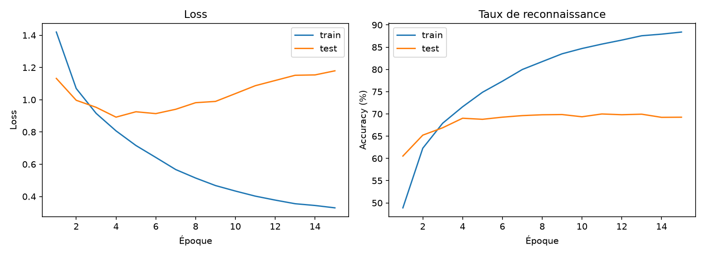
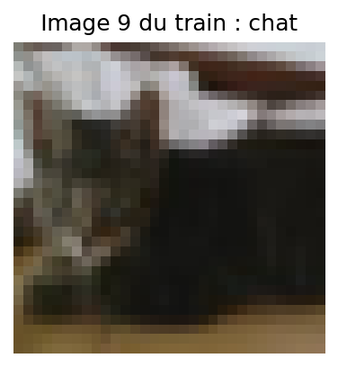
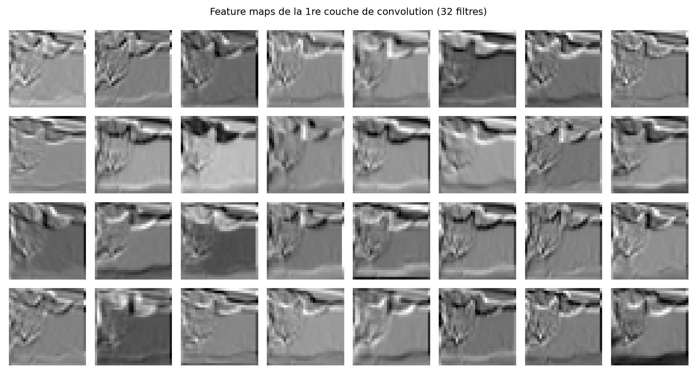
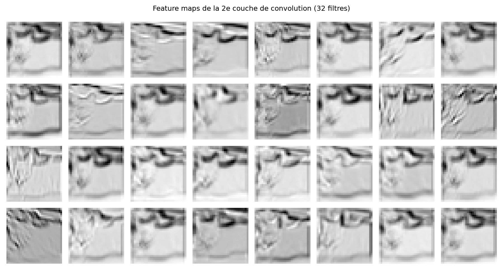

# TP3 : CNN sur CIFAR-10 (PyTorch)

Classification d'images CIFAR-10 (10 classes, images couleur 32×32) avec un petit réseau convolutif entraîné sur CPU, et visualisation des cartes de caractéristiques (feature maps) des deux couches de convolution.

## Objectif et données

- **Objectif** : construire un petit réseau convolutif capable de classer des images en 10 catégories, et visualiser ce que ses deux couches de convolution extraient d'une image.
- **Données** : CIFAR-10, 60 000 images couleur de 32×32 pixels réparties en 10 classes équilibrées (avion, automobile, oiseau, chat, cerf, chien, grenouille, cheval, bateau, camion), dont 50 000 pour l'entraînement et 10 000 pour le test. Le jeu est téléchargé automatiquement par torchvision.
- **Évaluation** : taux de reconnaissance (accuracy) sur les 10 000 images de test.

## Résultat

| Métrique (après 15 époques) | Valeur |
|---|---|
| Taux de reconnaissance sur le test | **69,26 %** |
| Taux de reconnaissance sur l'entraînement | 88,40 % |
| Loss de test minimale | 0,892 (époque 4) |
| Loss de test finale | 1,179 |

Conditions : Adam, learning rate 1e-3, batch de 32, graine 42, une seule exécution sur CPU.



### Lecture des courbes

- La loss de test est minimale à l'époque 4, puis remonte alors que la loss d'entraînement continue de baisser : le réseau **surapprend** à partir de là.
- L'accuracy de test plafonne autour de 69-70 % dès l'époque 4, pendant que celle d'entraînement atteint 88 %. L'écart final est d'environ 19 points.
- Le plafond s'explique en partie par la taille du modèle : seulement deux convolutions.

Remarque de méthode : le jeu de test est évalué à chaque époque uniquement pour tracer les courbes. Le score rapporté est celui de la dernière époque, pas le meilleur, afin de ne pas choisir l'époque sur le test.

## Architecture

```
Conv(3→32, 3×3) → ReLU → Dropout(0,3)
→ Conv(32→32, 3×3) → ReLU → MaxPool(2×2)
→ Flatten → Linear(8192→512) → ReLU → Dropout(0,5)
→ Linear(512→10)
```

Les images sont normalisées par canal avec la moyenne et l'écart-type de CIFAR-10.

## Feature maps

Image utilisée : l'image n° 9 du jeu d'entraînement (un chat), affichée en 32×32.



**Première couche** (sorties de `conv1`, avant ReLU). Chaque filtre produit une version de l'image qui met en valeur des contours, des contrastes ou des zones de luminosité différentes. La structure de l'image reste bien reconnaissable.



**Deuxième couche** (sorties de `conv2`). Les cartes sont plus contrastées et plus abstraites : certaines réagissent à des contours obliques ou à des textures, d'autres isolent des formes plus larges. Elles combinent les motifs simples détectés par la première couche.



## Lancer le code

```bash
pip install -r ../requirements.txt
python cnn_cifar10.py --epochs 15
```

Options : `--epochs`, `--batch-size`, `--lr`, `--seed`, `--num-workers`, `--data-dir`, `--out-dir`, `--image-index`.

CIFAR-10 est téléchargé automatiquement dans `data/` au premier lancement (environ 170 Mo). Le script enregistre dans `results/` les courbes, les feature maps, le modèle (`cnn_cifar10.pt`) et `results.json` avec l'historique complet.

Testé avec Python 3.13 et PyTorch sur CPU.

## Limites et pistes d'amélioration

- Une seule exécution : l'écart entre deux graines n'est pas mesuré.
- Pas de jeu de validation séparé : les hyperparamètres n'ont pas été optimisés.
- Pour réduire le surapprentissage : augmentation de données (retournements, recadrages), régularisation L2 (`weight_decay`), arrêt anticipé sur un jeu de validation, ou réseau plus profond avec BatchNorm.
